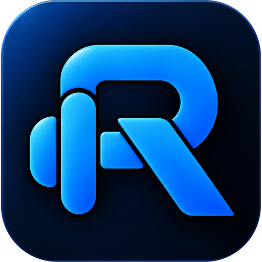
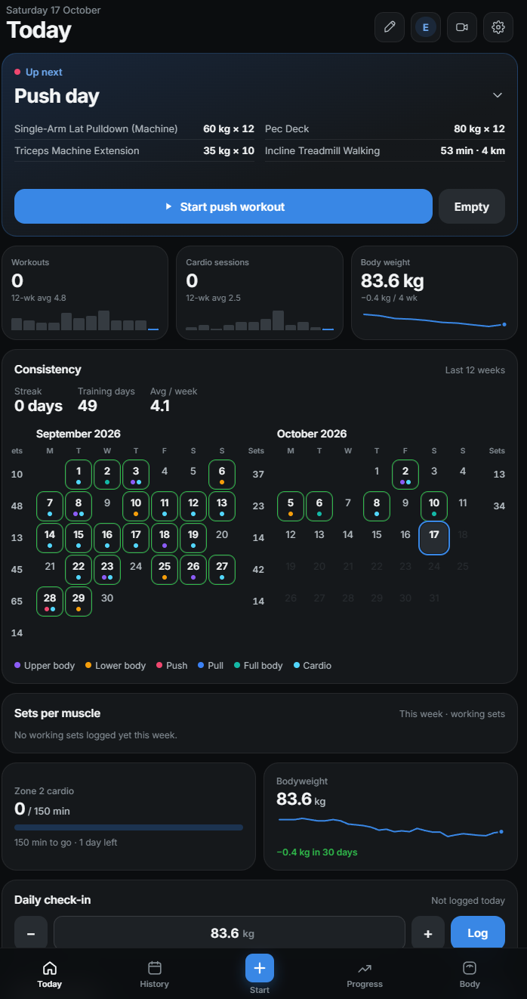
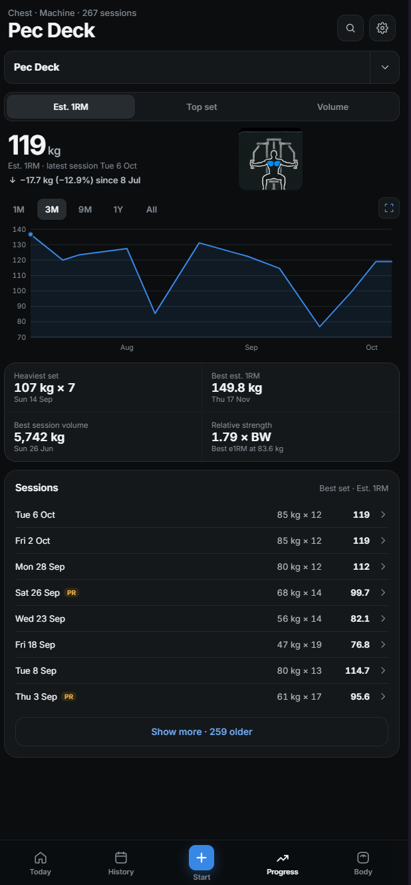
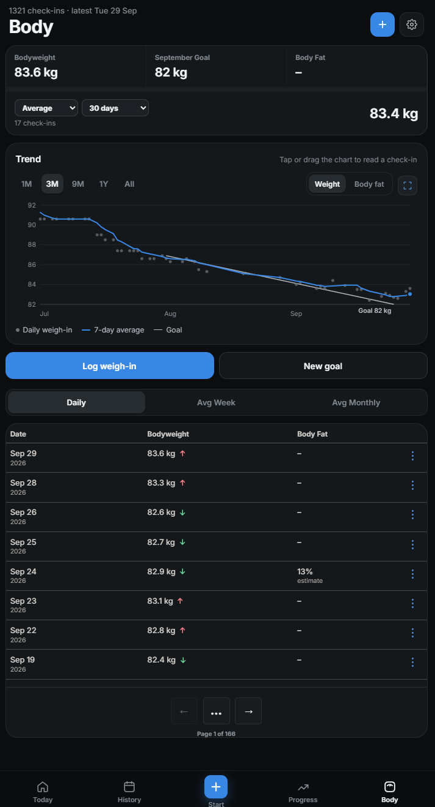
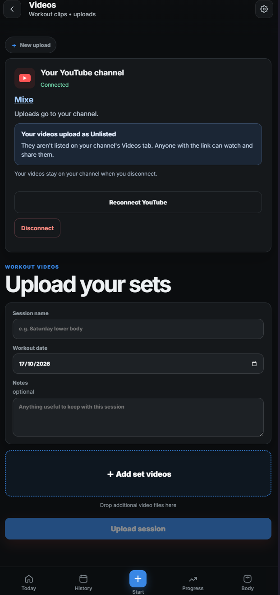

  

<h1 align="center">Relay</h1>

Relay, formerly Gym Logger, is a mobile-first app for recording workouts and following your progress. Keep strength training, cardio, body measurements and optional workout videos together in one place, with your own account and private training history.

Use it in your browser or add it to your phone's Home Screen for an app-like experience.

## Your training at a glance

**Home** brings together your weekly activity, training calendar, muscle-group set totals, cardio goal, body-weight trend and recent personal records. It also suggests a next workout based on previous sessions and lets you resume one already in progress.

Opening the app shows at most one prompt: **What's new**, the weekly review and the Home Screen guide take turns on later visits instead of queueing up. What's new is remembered on your account, so a second device does not repeat it, and a new account is not shown release notes for a release it started on.

Hold any Home section for 0.5 seconds, or tap the pencil, to customise the dashboard by rearranging cards, hiding sections you do not need and restoring them later. Your layout is saved to your account.

The bulb beside Home's date lists features worth trying, most useful first, and each tip has a button that opens the feature. How-to hints for a control, such as dragging a set, appear beside that control instead. A tip you ignore comes back a couple of times; opening it, using its button or **Got it** puts it away. Turn tips off in **Settings > Help & about**.

Comparing machines, training blocks, and splits with rep ranges each have a **setup guide** that runs inside the feature's own screens. A card at the bottom of the screen explains each step using your own lifts and recent workouts and highlights the control to use. The guide finishes when the feature is saved, so finishing it sets the feature up. Their tips offer **Show me how**, and **Settings > Help & about > Setup guides** lists all three, marking features you have already set up. **Exit guide** leaves at any point without changing anything. If you put one of these tips away or leave its guide before the feature is set up, the tip comes back to the bulb as a reminder after 7 days, then 14, then 28, and stops once you use the feature.

  

_Home: your next workout and training dashboard. Select the screenshot to view it full size._

## Log strength workouts

- Choose from the exercise library, save favourites or create your own exercises.
- Record sets, reps, weight and effort (RPE), with warmups, supersets and notes.
- In a live workout, **Finish**, **+** (add an exercise) and the **⋯** menu sit in the header, and **Discard workout** is in that menu. Tap a set to edit or delete it, and drag its handle to reorder. Ticking the last set of a planned exercise folds it away and shows its weekly muscle totals once, for all of its sets.
- Add your own workout types and colours in Settings; remove or restore types while keeping saved history. Save exercises to any workout type, even without a split, and starting that type fills them in.
- Build your own repeating training split in **Settings > Training > Your split**, with Upper / Lower, PPL, full body every other day and Cardio templates, custom workout types and rest days. **Edit split** on Home and **My splits** beside your profile's **Last 12 weeks** open one page with saved plans and templates. The blue-bordered active card contains its seven-day/calendar preview. Saved template cycles are disabled until their days change or the copy is deleted; sharing lives in each split's options. Up next follows your saved cycle.
- Use previous-session suggestions to pick up where you left off.
- Finishing a workout puts a summary at the top of Home straight away: time, sets and volume, the change from the last session of the same name, and any new records once it has synced. It points to **Compare machines** when an exercise was logged on a different machine from last time, and to **Set rep range** when a planned exercise has matched the same top set three sessions running. Dismiss it, or it goes when the next workout starts.
- Give a planned exercise a **rep range** (such as 8–12) in a split day or a workout type. When you start that workout, the exercise shows its target and what to do next: stay at the weight until every top set reaches the highest reps, then try the next weight up. Sets the plan left blank start with that weight suggested.
- Follow a live rest timer, with optional phone alerts and a reminder if a workout is left running.
- **Start** offers three choices: the workout that is up next, cardio or an empty workout. While a workout is running, Home shows it where Up next sits, with **Resume**.
- Tap today, or a planned day, in Home's week strip or the calendar to see that split day's exercises and start it now, so any day of your split can be trained today.
- Tap the live time under the workout name to correct it if you started the timer late or left it running. Enter the time trained so far and the clock keeps counting from there.
- Attach reusable machine photos and add custom numeric settings while naming a machine. **Save and pin** saves them together; choosing a saved machine loads its own settings.
- Use **Equipment photo > Select** to merge duplicate machines. Keep every photo and workout link together, and choose the cover, name and future settings to keep.
- Use an exercise's **⋮ menu** in **Training > Exercises** to **Hide from exercise lists**: it leaves the workout picker, swaps and split search but keeps its history, records and progress. The **Hidden** pill lists hidden exercises so you can show them again. Custom exercises can also be **renamed**; their workouts follow the new name.
- Open a custom exercise in **Training > Exercises**, then use its **⋮ menu > Merge with another exercise** to combine it with an official or another custom exercise of the same kind. Exercises with the same equipment and muscle groups are listed first; choose any other and Relay shows the equipment and muscles your custom exercise must change, with one button to change them before merging. History, records, machine photos and saved splits move to the destination; its muscle credits and existing settings are kept. Merges cannot be undone.
- Each saved workout keeps the machine settings used for that session.
- Resume the same active workout on your desktop or phone, with live edits on both devices. Phone alerts can remind you after 45 minutes without workout activity.
- Turn on **Auto-save** for unfinished workouts to have a workout you forgot to finish saved automatically after a time you choose, even with the app closed.
- If a workout was changed on another device after you opened it, saving asks whether to keep your version or load the latest one, so an out-of-date copy never silently replaces newer edits.
- Keep logging without a connection. After you have signed in once on a device, Relay opens from the data it saved there, shows an offline banner across the app, and syncs finished workouts when the server is reachable again. You can finish and start as many workouts as you like while offline.

Choose kilograms or pounds for weight entry and display.

## Review your history and progress

**Training > Sessions** lets you revisit and edit saved workouts, read notes and open machine photos. The existing calendar stays above the latest three weeks of sessions; **Show more** reveals older workouts.

**Training > Exercises** opens on a searchable exercise list with muscle filters, Recent first, A-Z and Most improved sorting, and eight-week estimated 1RM trends. Tap a lift for its chart, personal bests and session history. Open a session to see its completed sets before opening the workout. Return to **Exercises** with your search, filter, sort, list position, metric and range intact. A **Weight PR** celebrates a heavier completed working set; a **Volume PR** celebrates more reps in a set at a weight you have used before. You can also follow estimated one-rep max and weekly muscle-group set totals. **Cardio** remains in Training alongside Sessions and Exercises. The exercise list shows 10 lifts per page until you choose another size, which is remembered on that device. The filter button beside search holds the training block, equipment, sort order and page size. Muscle filters include direct and enabled partial credits. Open a lift and use the question mark beside its name to inspect its credits and choose a week and switch **Count partial sets** off or on. Choices carry forward until changed again; earlier weeks keep their settings. Home's **Sets per muscle** totals use each workout’s saved setting; **Show more** reveals remaining trained and untrained muscles. Its arrows step back through the last eight weeks, comparing each week with the one before.

Set different weekly set targets in **Settings > Training > Units & weekly goals > Muscle targets**. Muscles without a custom target use **Default weekly sets per muscle**; choose **Default** beside a muscle to reset it. Home, Training, split planning and the progress shown while logging use each muscle's target.

Choose a training block or **All time** from the Exercises filter button to change the existing charts, bests and session list. Tap Home's training block card, or **Training blocks** in that filter, to see one year at a time: a month-by-month bar of your blocks in their colours, and the current block's weeks compared with the last regular block. Tap a block on the bar to highlight it, or open every year full screen in landscape with a line for each week. From there, start, rename, recolour, redate or remove a block without deleting workouts. Choose today, 1 January or a custom past date, and optionally plan an end after 8 or 12 weeks or on a chosen date. Home shows the current block's week, the days left when a planned end is set, and the blocks timeline; customise the card to show the progress, the timeline or both; the planned end never closes the block by itself. The block containing a workout's date supplies its **Block PR** baseline; **All-time PR** still recognises lifetime achievements. A set that qualifies for both celebrates the all-time achievement once. Previous-set suggestions, lifetime totals and streaks retain their history. Home offers **Start a block** once you have trained in four different weeks. The weekly review shows the running block's week, and offers a new block when there is a reason to start one: four weeks trained with no block yet, a return after ten or more days off, a weight goal that changed direction, or three weeks of training without a new record.

Import original **Strength Level**, **Hevy** or **Strong** workout CSVs: choose the app in **Settings > Data & connections > Import & export**, select its export, then review before saving. Strong body-weight measurement exports work there too and keep existing check-ins. Relay workout and bodyweight CSVs, including those exported as Gym Logger, use the same picker, preserving check-in notes and body-fat values and skipping existing dates. Map incoming exercise names to your existing library during review, then update the review before saving. **Import history** lets you undo a newly tracked batch while keeping unrelated sessions and edited check-ins; earlier imports cannot be undone as a batch. You can also import a spreadsheet. Choose **Export data** beside any import source to select workout history, bodyweight check-ins or both, and a date range; both downloads two CSVs. A built-in CSV guide shows the columns and one-row-per-set layout and offers a template; files you make yourself need only date, exercise and reps columns, plus weight for weighted sets. Workout CSVs are for set history. For everything else, use **Full backup** in the same section to download a complete copy of your account (workouts, notes, cardio, check-ins, measurements, splits, settings and machine photos; videos are not included) and restore it later. Restoring shows what the backup holds beside what your account has now, and keeps a copy of your current data on the server first.

  

_Progress: exercise trends, personal records and previous sessions. Select the screenshot to view it full size._

## Track cardio and body measurements

**Cardio** records sessions on their own or alongside a workout. Add duration and optional machine or watch metrics such as distance, calories, average heart rate, speed, incline and cycling power. Compare activity across date ranges and set personal heart-rate ranges with **Edit** on **Training > Cardio > Weekly zone goals**. Start with a 150-minute weekly Zone 2 goal, change its minutes or zone, or add separate goals for other zones. Once ranges are set, sessions count only when average heart rate matches the personal range; until then they count as Zone 2. Saving updates the session and goals without a zone popup.

**Body** tracks body weight and optional body-fat measurements, with trends and a weight goal to help you follow changes over time. Each goal is marked by a dotted line in the check-in history; swipe it left to remove the goal, with **Undo** for a few seconds. Home has one **Body weight check-in** section. In **Edit Home layout**, choose **Customise** to preview weight only, body fat only, or combined with one save button. The one-button option saves weight and body fat together and undoes them together. Body fat on its own still requires today’s weight.

**Body measurements** records dated circumferences for neck, shoulders, chest, waist, hips, both upper arms, thighs and calves, wrist and ankle. Choose **Log measurements** on Body; enter any subset without a weigh-in, then review, edit or delete entries in **Measurement history**. Use its **Body part** filter for individual dated values and changes since the previous recorded value. Lengths follow your weight preference (cm with kg, inches with lb). These records stay private and are included in account backups.

  

_Body: weight trends, goals and daily check-ins. Select the screenshot to view it full size._

## Keep workout videos together

The optional video logger combines individual set clips into one workout video for YouTube. Arrange your clips, follow upload and processing progress, and keep timestamp links for reviewing your technique. Portrait and landscape clips keep their proportions, and phone alerts can let you know when the video is ready.

Video access depends on the administrator's settings. You can use the workout tracker without uploading videos.

Connect your own YouTube channel in **Settings** or **Video logger**. Choose your Google account
and channel, approve access, and confirm the channel shown before uploading. The administrator
configures Google once for the installation; users do not need API keys or credential files.

  

_Videos: connect your channel and upload workout clips as Unlisted videos. Select the screenshot to view it full size._

## Your account and sharing

Sign in with a username and password, personalise your name and profile photo, and keep your profile **Private** or choose **Friends only** or **Public** sharing within the app's sharing community.

**Sign out** in Settings signs out this device only, and asks first if it holds sets that have not synced. **Sign out everywhere** asks for confirmation, then ends every session for your account: connected devices return to sign-in immediately; sleeping or offline devices check when they reconnect. Signing out clears the device's cached account data and unfinished workouts, and stops its phone alerts. When a session ends without signing out on that device (it expired, or it was signed out from another device or by a password change), the workout on it is kept: the sign-in screen says you were signed out and starts with your username, and the workout syncs after you sign back in. A different account signing in discards it. Temporary connection failures alone do not sign you out.

Shared profiles include workouts and your profile photo. You choose separately whether to share machine photos, body measurements, goals, cardio and notes. Friendships are mutual: send a friend request, and once it is accepted you both see each other's shared training. Requests always need accepting, even for public profiles. **Recent Friends Activity** on Home shows the latest workout or cardio session from each friend; tap the smiley to react with 👍, ❤️, 💪, 🔥, 👏, 🏆 or 🏃, and react to individual workouts on their shared profile too. Shared profiles show lifetime workout, cardio and combined training time. Reactions to your workouts appear in the compact notification bell; opening it marks displayed notices read automatically. Search shared accounts by display name, username or the account UUID shown on Profile. Shared profiles do not display usernames or uploaded videos.

The **Social** tab has two parts. **Feed** starts with a row of your friends, those training now first, each with a dot for every day they trained in the last week, followed by the workouts you and your friends share. **Friends** holds friend requests, people search, your friends, suggestions, requests you sent and blocked members. To add someone in person, tap the QR button on your Profile or **QR code** beside people search; scanning it with a phone camera, or with **Scan** in the same sheet, sends you a friend request (with **Undo**), after signing in or creating an account if needed. Profiles offer **Add friend**, **Accept** or **Decline**, and a menu to cancel a request, remove a friend or block. Your profile-sharing choices still apply, and Home keeps a compact friends preview; **+N more** shows a spinner and adds three friends inline, keeping the expanded list during refreshes.

Administrators can manage accounts, registration, video access and private app feedback from the admin console. Accounts come first, with search and filters for reset requests, disabled accounts and temporary passwords; each account is one line showing live online status, a workout in progress or its last-active time, and opens to its details and actions. Account limits, storage and app versions are folded under **Server**.

Settings opens with **Training**, **Appearance**, **Notifications**, **Account & privacy**,
**Data & connections** and **Help & about**. Open a focused section without losing unfinished edits.
Use **Search settings & profile** in Settings to jump to rest timers, username changes,
sharing, data tools and other sections. **Settings > Appearance > App theme** offers **Dark**, **Light** and
**Automatic** modes (Automatic, the default, follows the phone's light or dark setting) and six accent colours;
the selection applies immediately and stays on that device.

## Getting started

Sign in or create an account if registration is available. The guided tour introduces the main screens, then offers to import your existing workout history from a CSV file; tap **Start** to log your first workout. In **Settings**, you can replay the guide, find **Add to Home Screen** instructions, adjust training and display preferences, enable phone alerts, and send feedback or feature requests.

For more detail:

- [Release notes](docs/RELEASE-NOTES.md): what has changed in the app.
- [Contributing](CONTRIBUTING.md): how to report issues or help improve it.
- [Technical reference](docs/TECHNICAL-REFERENCE.md): local setup, development checks and administration.
