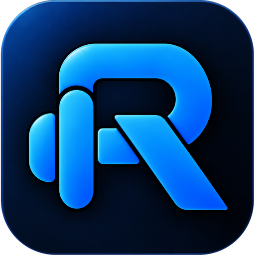

  

<h1 align="center">Relay</h1>

Relay, formerly Gym Logger, is a mobile-first app for recording workouts and following your progress. Keep strength training, cardio, body measurements and optional workout videos together in one place, with your own account and private training history.

Use it in your browser or add it to your phone's Home Screen for an app-like experience.

## Your training at a glance

**Home** brings together your weekly activity, training calendar, muscle-group set totals, cardio goal, body-weight trend and recent personal records. It also suggests a next workout based on previous sessions and lets you resume one already in progress.

Hold any Home section for 0.5 seconds, or tap the pencil, to customise the dashboard by rearranging cards, hiding sections you do not need and restoring them later. Your layout is saved to your account.

  

*Home: your next workout and training dashboard. Select the screenshot to view it full size.*

## Log strength workouts

- Choose from the exercise library, save favourites or create your own exercises.
- Record sets, reps, weight and effort (RPE), with warmups, supersets and notes.
- Add your own workout types and colours in Settings; remove or restore types while keeping saved history.
- Use previous-session suggestions to pick up where you left off.
- Follow a live rest timer, with optional phone alerts and a reminder if a workout is left running.
- Attach reusable machine photos to remember equipment settings or setups.
- Resume an active workout after returning to the app, then save it to your history.

Choose kilograms or pounds for weight entry and display.

## Review your history and progress

**Training > Sessions** lets you revisit and edit saved workouts, read notes and open machine photos. The existing calendar stays above the latest three weeks of sessions; **Show more** reveals older workouts.

**Training > Exercises** opens on a searchable exercise list with muscle filters, Recent first, A-Z and Most improved sorting, and eight-week estimated 1RM trends. Tap a lift for its chart, personal bests and session history. Open a session to see its completed sets before opening the workout. Return to **Exercises** with your search, filter, sort, list position, metric and range intact. A **Weight PR** celebrates a heavier completed working set; a **Volume PR** celebrates more reps in a set at a weight you have used before. You can also follow estimated one-rep max and weekly muscle-group set totals. **Cardio** remains in Training alongside Sessions and Exercises. The exercise list starts at 10 lifts per page; its three-line options button changes the page size. Muscle filters include direct and enabled partial credits. Use the question mark beside a lift to inspect its credits and choose a week and switch **Count partial sets** off or on. Choices carry forward until changed again; earlier weeks keep their settings. **Sets per muscle** is also at the bottom of Training. Switch between **This week** and **4 weeks** to see totals using each workout’s saved weekly setting; **Show more** reveals remaining trained and untrained muscles on both Home and Training.

Import original **Strength Level**, **Hevy** or **Strong** workout CSVs: choose the app in **Settings > Data & connections > Import & export**, select its export, then review before saving. Strong body-weight measurement exports work there too and keep existing check-ins. Relay workout and bodyweight CSVs, including those exported as Gym Logger, use the same picker, preserving check-in notes and body-fat values and skipping existing dates. You can also import a spreadsheet. Choose **Export data** beside any import source to select workout history, bodyweight check-ins or both, and a date range; both downloads two CSVs. A built-in CSV guide shows the columns and one-row-per-set layout and offers a template; files you make yourself need only date, exercise and reps columns, plus weight for weighted sets. Workout CSVs are for set history rather than a full backup of notes, photos, videos and other account data.

  

*Progress: exercise trends, personal records and previous sessions. Select the screenshot to view it full size.*

## Track cardio and body measurements

**Cardio** records sessions on their own or alongside a workout. Add duration and optional machine or watch metrics such as distance, calories, average heart rate, speed, incline and cycling power. Compare activity across date ranges and work towards a weekly Zone 2 target.

**Body** tracks body weight and optional body-fat measurements, with trends and a weight goal to help you follow changes over time. Home offers separate **Body weight check-in**, **Body fat check-in** and **Combined check-in** sections. Add, hide, resize and arrange them through **Edit Home layout**. Weight can be logged without body-fat percentage; logging body fat requires today’s weight.

  

*Body: weight trends, goals and daily check-ins. Select the screenshot to view it full size.*

## Keep workout videos together

The optional video logger combines individual set clips into one workout video for YouTube. Arrange your clips, follow upload and processing progress, and keep timestamp links for reviewing your technique. Portrait and landscape clips keep their proportions, and phone alerts can let you know when the video is ready.

Video access depends on the administrator's settings. You can use the workout tracker without uploading videos.

Connect your own YouTube channel in **Settings** or **Video logger**. Choose your Google account
and channel, approve access, and confirm the channel shown before uploading. The administrator
configures Google once for the installation; users do not need API keys or credential files.

  

*Videos: connect your channel and upload workout clips as Unlisted videos. Select the screenshot to view it full size.*

## Your account and sharing

Sign in with a username and password, personalise your name and profile photo, and keep your profile **Private** or choose **Friends only** or **Public** sharing within the app's sharing community.

Shared profiles include workouts and your profile photo. You choose separately whether to share machine photos, body measurements, goals, cardio and notes. Friendships are mutual: send a friend request, and once it is accepted you both see each other's shared training. Requests always need accepting, even for public profiles. **Recent Friends Activity** on Home shows the latest workout or cardio session from each friend; tap the smiley to react with 👍, ❤️, 💪, 🔥, 👏 or 🏆, and react to individual workouts on their shared profile too. Shared profiles show lifetime workout, cardio and combined training time. Reactions to your workouts appear in the compact notification bell; opening it marks displayed notices read automatically. Search shared accounts by display name, username or the account UUID shown on Profile. Shared profiles do not display usernames or uploaded videos.

The **Social** tab has two parts. **Friends** lists each friend once with their latest session, a seven-day activity strip and a reaction button. **Find** holds friend requests, people search, requests you sent and blocked members. Profiles offer **Add friend**, **Accept** or **Decline**, and a menu to cancel a request, remove a friend or block. Your profile-sharing choices still apply, and Home keeps a compact friends preview; **+N more** shows a spinner and adds three friends inline, keeping the expanded list during refreshes.

Administrators can manage accounts, registration, video access and private app feedback from the admin console.

Settings opens with **Training**, **Appearance**, **Notifications**, **Account & privacy**,
**Data & connections** and **Help & about**. Open a focused section without losing unfinished edits.
Use **Search settings & profile** in Settings to jump to rest timers, username changes,
sharing, data tools and other sections. **Settings > Appearance > App theme** offers five accent colours;
the selection applies immediately and stays on that device.

## Getting started

Sign in or create an account if registration is available. The guided tour introduces the main screens, then offers to import your existing workout history from a CSV file; tap **Start** to log your first workout. In **Settings**, you can replay the guide, find **Add to Home Screen** instructions, adjust training and display preferences, enable phone alerts, and send feedback or feature requests.

For more detail:

- [Release notes](docs/RELEASE-NOTES.md): what has changed in the app.
- [Contributing](CONTRIBUTING.md): how to report issues or help improve it.
- [Technical reference](docs/TECHNICAL-REFERENCE.md): local setup, development checks and administration.
